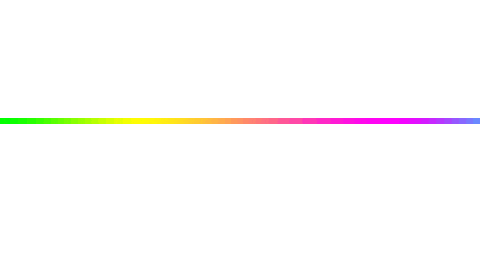

  
  
  
  
  
  <h1 align="center">✨From UI to Database✨</h1>
  <h3 align="center">Pixel-perfect on the front, reliable on the back.</h3>
  
  
  I started in frontend and grew into full-stack. Today I build interfaces with React and Next.js and services with Go,
  on top of PostgreSQL, Redis and Kafka. I care about clean code, modular architecture and systems that are easy to 
  maintain. Give me an idea, and I'll take it from the first sketch to production.

  ## My Stack 🛠️ 

  

  

  

  - Frontend
  

    
  

  

  - Tools
  

    
  

  - Backend & Database
  

    
  

   

## Let's connect 🤝

  

  

 

## Some Stats 📊

  
  

   

  

  

